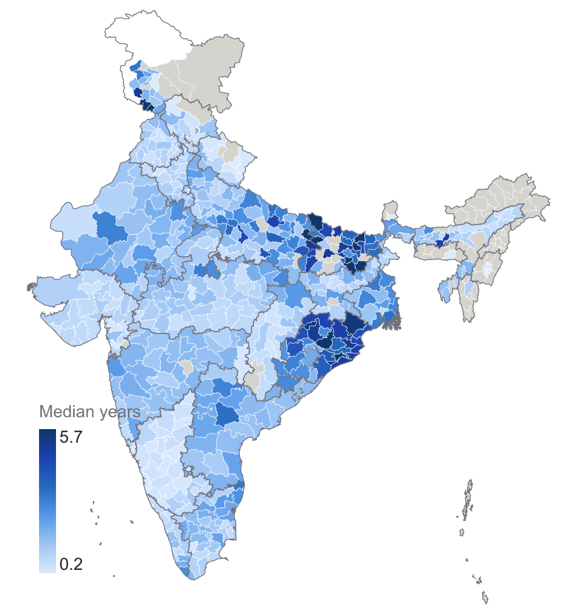
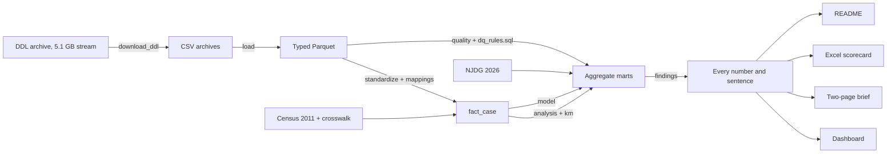

# Where Justice Gets Stuck

Where and why Indian lower courts are delayed, from **80,935,944 cases** filed 2010-2018, with 2026 pendency for context.

**[Open the live dashboard](https://where-justice-gets-stuck.streamlit.app/)** | [Read the two-page brief](outputs/where_justice_gets_stuck_brief.pdf)

Indian district and subordinate courts held 4.99 crore pending cases in July 2026. This project finds where those cases stall, using case-level records and a data-quality layer that documents every problem found along the way.

> **Case data ends in 2018.** These findings describe that period, not courts today. 2026 figures come from NJDG and are context only.



## The headline

The usual measure of delay is misleading. Closed cases alone give a median of **181 days**, but counting cases still open gives **450 days**, 2.5 times longer, because the slowest cases are the ones that have not finished. 19% of cases are still open after five years.

## Findings

| Question | Finding | |
|---|---|---|
| How long does justice take? | Half of all cases take more than 450 days to close once open cases are counted. Closed cases alone say 181 days, which understates it 2.5 times. 19% of cases are still open after five years. Civil suits take a median of 983 days, while bail takes 9. | [chart](outputs/charts/q2_survival.png) |
| Where do cases get stuck? | 38% of cases that never closed (80.2 lakh) were last listed for admission, summons, notice or appearance: the steps that get parties to court. Evidence is the largest single stage at 22%. Criminal cases sit in those early steps more often than civil ones (41% against 30%). | [chart](outputs/charts/q1_stages.png) |
| Does your district decide your speed of justice? | Yes: a slow district (90th percentile) takes 6.5 times as long as a fast one (10th percentile), 1,200 days against 184. States explain 67% of the variation after adjusting for case mix, so districts matter but states matter more. Only 55 of 558 districts disposed of as many cases as were filed in 2016-18. | [chart](outputs/charts/q5_map.png) |
| Which laws clog the system? | The Indian Penal Code holds the most open cases (75.8 lakh), followed by the Code of Civil Procedure (39.5 lakh). Among large groups, Specific Relief Act cases are slowest at a median 3.8 years. Section 138 (cheque bounce) is the largest single section by volume, with 19.6 lakh NI Act cases filed 2010-2018 still open at the end of 2018 (8% of all open cases). That fits the Supreme Court's 35.2 lakh for end-2019, which also counts older cases, but this data alone cannot confirm it. | [chart](outputs/charts/q3_laws.png) |
| Do judge transfers slow cases? | Much less than it first appears. Cases that changed judges took a median 516 days against 13, and matched trials still differ by 464 days, but slow cases simply have more time to see a transfer. A fairer test uses what a slow case cannot influence: how long the judge had left at filing. With a judge about to leave, the share closed within two years was 2.9 points lower in magistrate trials and 5.4 points lower in sessions trials. | [chart](outputs/charts/q4_judges.png) |
| When would the backlog clear? | On 2016-18 flows, it would not: filings outran recorded disposals in 28 of 31 states. Even if filings stopped, the 2026 backlog equals 4.6 years of disposals nationally, led by Bihar (13.0), West Bengal (12.8) and Odisha (11.0). | [chart](outputs/charts/q7_backlog.png) |
| How visible are women in court? | Women are 29% of named petitioners and 15% of defendants, but only about 10% of advocates. Family cases are the exception among litigants, with women as 52% of petitioners. | [chart](outputs/charts/q6_women.png) |
| How do cases end? | Only 51% of closures are decided on the merits. 20% carry a label too vague to say how the case ended, 10% are settled or sent to Lok Adalat, and 7% are withdrawn or lapse. Cheque-bounce cases stand out: only 25% end on the merits, while 37% are settled or withdrawn. | [chart](outputs/charts/q8_outcomes.png) |
| How long until the first hearing? | Half of cases get a first hearing within 30 days, but one in ten waits more than 416 days. Among large states the median runs from 1 day in Punjab to 122 days in Odisha. | [chart](outputs/charts/q9_first_hearing.png) |
| What drives delay? | Case mix does not explain the gaps between states. With case type, filing year and the people involved held constant, a case closes at 0.43 times the rate of a comparable Maharashtra case in Bihar and 0.43 in Odisha, against 1.71 in Karnataka: a 4.0-fold gap. Cases with a named defendant's advocate close 21% more slowly, and those with a woman petitioner 9% more slowly. | [chart](outputs/charts/q10_model.png) |

Every figure has its limits spelled out in [the brief](outputs/where_justice_gets_stuck_brief.pdf), the dashboard and [docs/methods.md](docs/methods.md).

## What is here

| Deliverable | Where |
|---|---|
| DuckDB + Parquet pipeline: loaders, SQL rules, act-name mapping | [pipeline/](pipeline/), [sql/dq_rules.sql](sql/dq_rules.sql) |
| Excel data-quality scorecard, with live formulas | [outputs/data_quality_scorecard.xlsx](outputs/data_quality_scorecard.xlsx) |
| Streamlit dashboard: findings, district map, state profiles, data-quality explorer, what-if calculator | [Live](https://where-justice-gets-stuck.streamlit.app/), [dashboard/](dashboard/) |
| Two-page brief with the top findings | [outputs/where_justice_gets_stuck_brief.pdf](outputs/where_justice_gets_stuck_brief.pdf) |

### Data-management work

| Work | What was built | Where |
|---|---|---|
| Validation rules | 48 rules across completeness, validity, consistency, uniqueness and linkage; 36 found failures | [sql/dq_rules.sql](sql/dq_rules.sql) |
| Standardisation | 17,964 of 29,856 raw act labels mapped to 60 canonical acts, covering 95% of cases with an act record; stages, case types and outcomes too | [pipeline/mappings.py](pipeline/mappings.py), `data/mart/map_*.csv` |
| Coverage check | Cases by state and year, compared with NJDG: share correlation 0.98 | Coverage sheet in the scorecard, Data quality page |
| Documentation | Data dictionary and schema diagram of the files as they really are | [docs/data_dictionary.md](docs/data_dictionary.md) |
| Issue log | Every rule failure and anomaly, with severity, sample records and status | Issue log sheet, Data quality page, [docs/analyst_issues.csv](docs/analyst_issues.csv) |
| Scorecard | Quality scores by state and dimension, with adjustable weights | [outputs/data_quality_scorecard.xlsx](outputs/data_quality_scorecard.xlsx) |

## Run it

The [live dashboard](https://where-justice-gets-stuck.streamlit.app/) needs no setup. To run it yourself, it needs only the small aggregate tables included here:

```
python -m venv .venv
.venv\Scripts\activate
pip install -r requirements.txt
streamlit run dashboard/app.py --server.address 127.0.0.1
```

To rebuild everything from the source data (a 5.1 GB stream, of which about 2 GB is kept, plus about 2 GB of Parquet):

```
python -I pipeline/run_all.py                 # all 81M rows
python -I pipeline/run_all.py --pilot 01,08   # a trial on Maharashtra and Bihar, in separate folders
```

Tests: `pytest tests`. They cover the survival estimator against `lifelines`, the label rules on real labels, the downloader, the Excel formulas against an independent calculation, every dashboard page, and reconciliation of the full build when it is present. GitHub Actions runs them on every push.

### Host the dashboard

The [live copy](https://where-justice-gets-stuck.streamlit.app/) runs on [Streamlit Community Cloud](https://streamlit.io/cloud) and updates when `main` changes. To host your own, point a new app at this repository with `dashboard/app.py` as the main file. It installs the short [dashboard/requirements.txt](dashboard/requirements.txt), and no secrets or row-level data are needed. The case data licence is non-commercial, so keep any hosted copy non-commercial too.

## How it is built



```
pipeline/
  download_ddl.py   stream the Dropbox archive, keeping only the CSV copies, with CRC checks
  load.py           convert to typed Parquet; drops the linkable case number
  mappings.py       rules that standardise acts, stages, case types and outcomes
  standardize.py    mapping tables, geography, and the analysis table fact_case
  quality.py        run the rule catalogue; write results, samples and the issue log
  analysis.py       the questions, as small aggregate tables
  km.py             Kaplan-Meier from counts, exact at any scale
  model.py          Cox model of what drives time to closure
  findings.py       every number and sentence used downstream
  charts.py         one definition of each chart
  scorecard.py      the Excel workbook
  brief.py          chart images and the two-page PDF
  run_all.py        everything, in order
sql/dq_rules.sql    the rule catalogue
dashboard/          the Streamlit app, reading data/mart only
docs/               methods, data dictionary, schema, analyst issue log, design source
data/mart/          aggregate tables, safe to share
data/geo/           simplified district boundaries
```

The design decisions worth a look are in [docs/methods.md](docs/methods.md), including the checks that caught real errors while this was built.

## Sources and licences

The code is under the [MIT licence](LICENSE). The data is not: derived tables and charts carry **CC BY-NC-SA 4.0, for non-commercial use only**. See [DATA_LICENSE.md](DATA_LICENSE.md).

- **Case data:** [Development Data Lab](https://www.devdatalab.org/judicial-data), eCourts cases 2010-2018. Cite Ash, Asher, Bhowmick, Bhupatiraju, Chen, Devi, Goessmann, Novosad and Siddiqi (2025), *In-Group Bias in the Indian Judiciary*, The Review of Economics and Statistics.
- **Pendency and judge numbers:** NJDG and the Department of Justice, via [Lok Sabha Unstarred Question 3371](https://sansad.in/getFile/lsapps/loksabhaquestions/annex/188/AU3371_Lq6K9K.pdf), 7 Aug 2026.
- **Section 138 benchmark:** [In Re: Expeditious Trial of Cases under Section 138 NI Act](https://api.sci.gov.in/supremecourt/2020/9631/9631_2020_31_501_27616_Judgement_16-Apr-2021.pdf), Supreme Court of India, 16 Apr 2021.
- **Population:** Census 2011, via [this mirror](https://github.com/nishusharma1608/India-Census-2011-Analysis).
- **Boundaries:** [DataMeet India community](https://github.com/datameet/maps), CC BY 4.0. For display only, and not an official map of India.
- **Dashboard design:** generated with Google Stitch, see [docs/design/](docs/design/stitch_design_tokens.md).
