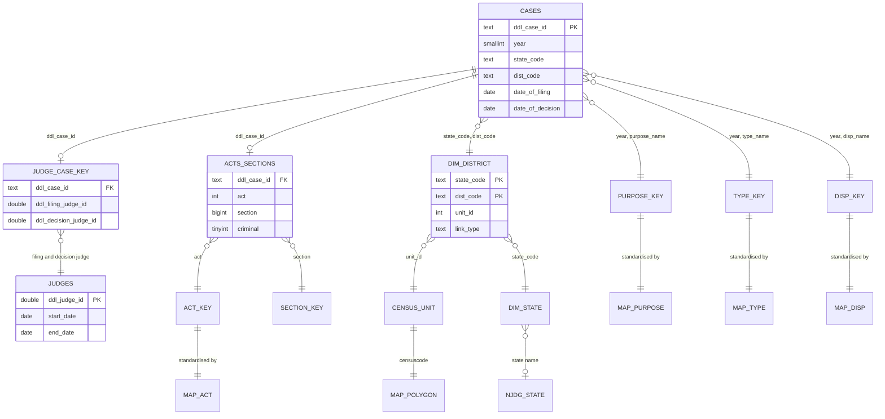

# Data dictionary

This records the schema as it actually is in the files, including where it differs from DDL's published metadata.

## Source tables (Development Data Lab, eCourts)

### `cases_YYYY` — 80,935,944 rows, one row per case

| Column | Type in Parquet | Meaning | Notes |
|---|---|---|---|
| `ddl_case_id` | text | DDL's case ID, unique across all years | **The last four digits often differ from the filing year.** Use `year`, and never parse a year from the ID. |
| `year` | smallint | Filing year | Matches `date_of_filing` in every row |
| `state_code` | text | eCourts state code | Zero-padded, so keep as text |
| `dist_code` | text | eCourts district code, unique within a state | Some codes are statewide tribunals, not places |
| `court_no` | text | Court number within a district | |
| `cino` | **dropped at load** | eCourts case number | Links a row to a named record. Not needed, so never stored. |
| `judge_position` | text | Cleaned judge designation | |
| `female_petitioner` | smallint | Gender predicted from name | In the files but **missing from DDL's metadata** |
| `female_defendant` | smallint | Gender predicted from name | |
| `female_adv_pet` | smallint | Petitioner advocate's predicted gender | |
| `female_adv_def` | smallint | Defendant advocate's predicted gender | |
| `type_name` | integer | Case-type code | Decode with `type_name_key` on code **and year** |
| `purpose_name` | integer | Purpose of the last or next hearing | Decode with `purpose_name_key` on code **and year** |
| `disp_name` | integer | Disposition code | Decode with `disp_name_key` on code **and year** |
| `date_of_filing` | date | Filing date | Always 2010-2018 |
| `date_of_decision` | date | Decision date | Blank for undecided cases. Raw values run from year 10 to well past 2030. |
| `date_first_list` | date | First hearing | |
| `date_last_list` | date | Most recent hearing | |
| `date_next_list` | date | Next scheduled hearing | One raw value has a year above 2,000,000 |
| `date_parse_failures` | tinyint | Added at load: date strings that would not parse | Audit field |

Gender codes: `1` female, `0` male, `-9998` name unclear, `-9999` name missing. Two raw formats exist (`0 male` and `0`), and the loader reads both.

### `acts_sections` — 76,811,357 rows, at most one row per case

Two gaps to know about: about 9M rows have IDs ending 2019 or 2020 and match no case, because the case files stop at 2018. And act records are thin for early years, covering about half of 2010-2012 cases but 94-97% from 2015.

| Column | Meaning | Notes |
|---|---|---|
| `ddl_case_id` | Join key | |
| `act` | Act code | 29,857 raw labels in `act_key` |
| `section` | Section code | 2.1M raw labels in `section_key` |
| `bailable_ipc` | Bailable flag, IPC only | Not used |
| `number_sections_ipc` | Number of sections, IPC only | Not used |
| `criminal` | DDL's criminal flag | Marks cheque-bounce, traffic and excise prosecutions as non-criminal, so `case_family` is derived from the act instead |

### `judges_clean` — 98,478 rows, one row per judge posting

| Column | Meaning | Notes |
|---|---|---|
| `ddl_judge_id` | Judge posting ID | |
| `state_code`, `dist_code`, `court_no` | Where | |
| `judge_position` | Designation | |
| `female_judge` | Predicted gender | |
| `start_date`, `end_date` | Tenure in this post | **Written `DD-MM-YYYY`**, unlike the case table. `end_date` is blank for 18,158 postings. |

### `judge_case_merge_key` — 12,901,146 rows

Links cases to judges with `ddl_case_id`, `ddl_filing_judge_id` and `ddl_decision_judge_id`. DDL's metadata uses different column names. Links exist only for cases DDL flags as criminal.

### Key tables

| Table | Rows | Joined on |
|---|---|---|
| `type_name_key` | 62,714 | `year`, `type_name` |
| `purpose_name_key` | 68,125 | `year`, `purpose_name` |
| `disp_name_key` | 462 | `year`, `disp_name` |
| `act_key` | 29,857 | `act` |
| `section_key` | 2,113,919 | `section` |
| `cases_state_key` | 287 | `state_code` |
| `cases_district_key` | 632 | `state_code`, `dist_code` (two codes have two spellings) |
| `cases_court_key` | 59,428 | `state_code`, `dist_code`, `court_no` |

## Tables built by this project

### `fact_case` — one row per case, no case ID

The source columns above, minus the ID and raw codes, plus:

| Column | Meaning |
|---|---|
| `type_category` | Standardised proceeding type (`pipeline/mappings.py`) |
| `stage` | Standardised hearing stage (`pipeline/mappings.py`) |
| `disp_group`, `disp_label` | Standardised outcome group, and the raw outcome label |
| `act_canonical`, `act_family` | Standardised act and its family |
| `has_act_row`, `has_judge_row` | Whether each join found a match |
| `filing_judge`, `decision_judge` | Judge posting IDs |

Added on top of it in the view `base` (`pipeline/analysis.py`):

| Column | Definition |
|---|---|
| `usable` | Filed, and not decided before filing or after 31 Dec 2020 |
| `closed` | Usable, and decided on or before 31 Dec 2018 |
| `never_decided` | No decision date at all |
| `t_days` | Days from filing to decision if closed, otherwise to 31 Dec 2018 |
| `case_category` | `type_category`, overridden by the act where the act is more specific (cheque bounce, traffic) |
| `case_family` | Criminal, civil or unknown, from the act, then from the case-type label |

### `dim_district` — 630 rows

Each DDL district and its Census 2011 unit, with `link_type` recording how the link was made: `ddl_crosswalk`, `renamed`, `court_seat`, `carved_after_2011`, `listed_under_other_state` or `non_territorial`.

### Mart tables (`data/mart/`)

Small aggregates, safe to share, and all the dashboard needs.

| Table | Grain | Answers |
|---|---|---|
| `headline` | One row | Totals used everywhere |
| `q1_stage`, `q1_stage_family`, `q1_stage_state` | Stage; stage x family; stage x state | Where cases get stuck |
| `q2_km_summary`, `q2_km_curves` | Group; group x day | How long justice takes |
| `q2_sensitivity_transfer` | Definition of closure | Sensitivity to transfers |
| `q3_acts`, `q3_sections`, `q3_section_138_test` | Act; act x section; one row | Which laws clog the system |
| `q4_overall`, `q4_pairs`, `q4_tenure_pairs` | Group; matched groups | Judge transfers |
| `q5_districts` | Census 2011 unit | The district map |
| `q6_women_state`, `q6_women_category`, `q6_women_year` | Role x group | Women in court |
| `q7_backlog` | NJDG state | When the backlog clears |
| `q8_outcomes`, `q8_verdicts` | Group x outcome; group | How cases end |
| `q9_first_hearing` | Group | Time to first hearing |
| `q4_judge_tenure` | State | Time a judge stays in a post |
| `model_hazard_ratios`, `model_summary.json` | Model term | What drives delay |
| `state_acts`, `q5_state_excluding_flagged` | State x act; state | State profile |
| `dq_state_scores`, `dq_year_scores` | State; filing year x dimension | Data-quality scores |
| `coverage_*` | State x year and similar | Coverage checks |
| `dq_results`, `dq_rules.csv`, `issue_log.csv` | Rule x state x year; rule; issue | Data quality |
| `map_act.csv` | Raw act label | Every label and what it mapped to |

## Schema

