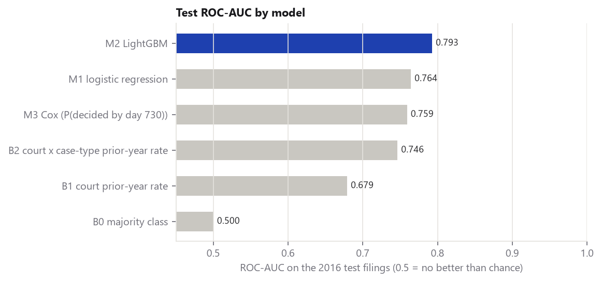
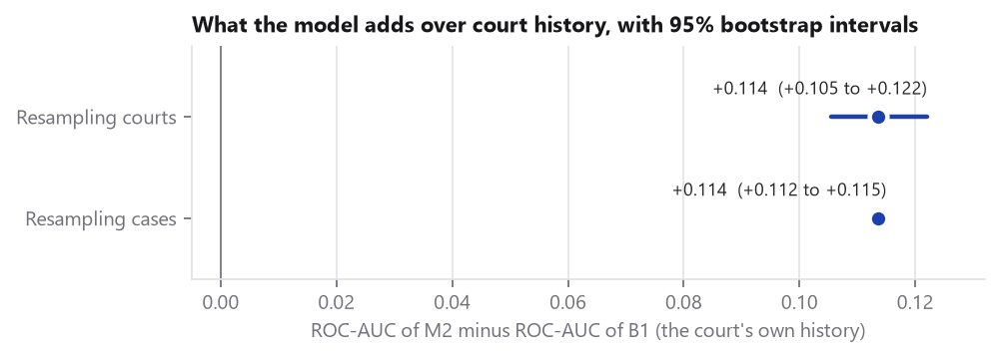
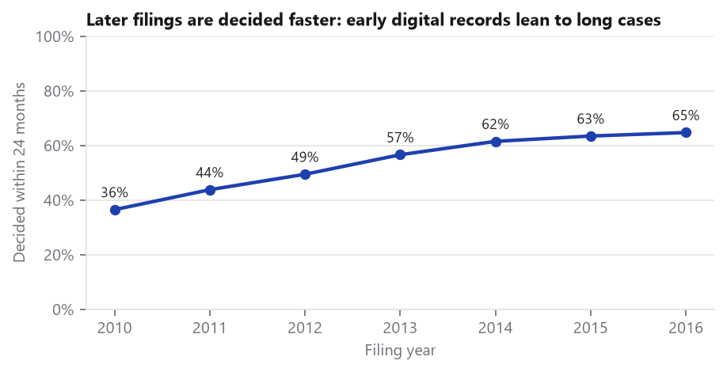
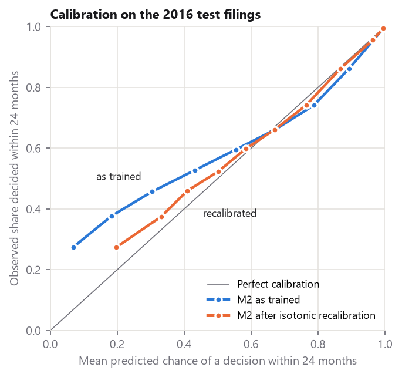
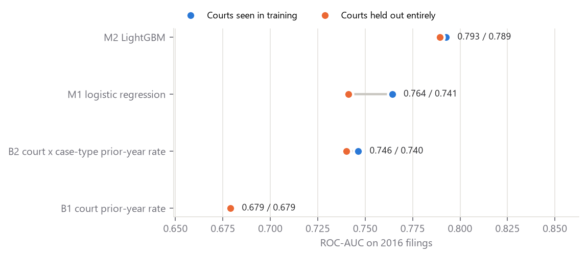
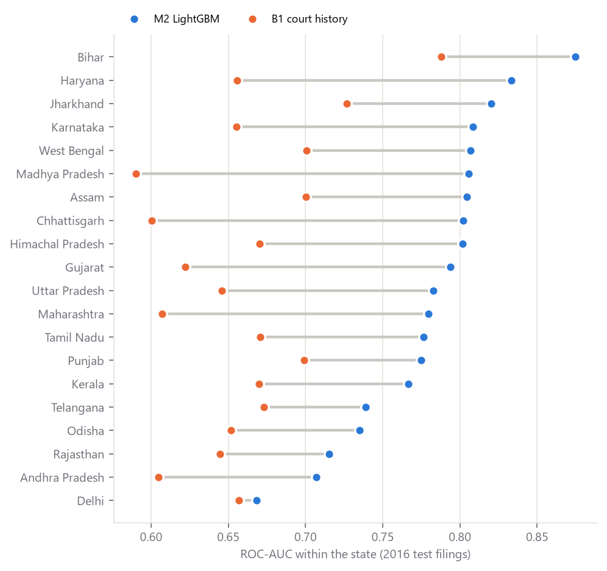
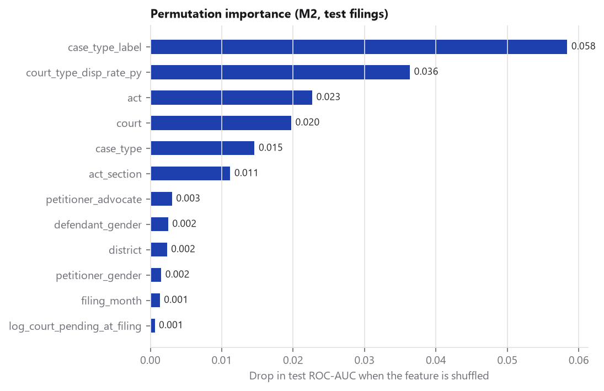

# Delay-risk model: proof of concept

*Generated by `make report` from logged runs; do not edit by hand. Profile `full`, training session `20261117-170645`,
evaluation run `c7d5b105ba`, commit `0fcf707`, feature version `v1-38f6775d`, split version `771b545cad169d21`.*


## Question

When a case is filed in an Indian district or subordinate court, can we predict whether it will be decided within
24 months, and how much does a model add over each court's own history? Put another way: **does the case matter, or
mostly the court?**

This is research on 2010-2018 records. It is not a tool for deciding anything about an individual case
([model card](../docs/model_card.md)).

## The answer

Mostly the case. With only case features (type, act and section, parties) the model reaches a test ROC-AUC of 0.770; with only court features it reaches 0.679.

The full model (M2) adds +0.114 ROC-AUC over the court's own prior-year disposal rate (B1): 0.793 against 0.679. The 95% interval is +0.105 to +0.122 when whole courts are resampled, and +0.112 to +0.115 when cases are resampled (1,000 resamples each). Both intervals exclude zero, so the gain is not resampling noise.

Against the court's own rate for the same case type (B2), the gain is +0.046 (case-level interval
+0.046 to +0.047): B2 alone closes 59% of the distance from B1 to M2. On courts
held out of training entirely, M2 scores 0.789, 0.003 lower than on seen
courts, and its gain over B1 there is +0.110 (+0.090 to +0.135, resampling courts).





## Data

[Development Data Lab](https://www.devdatalab.org/judicial-data) eCourts records: 80,935,944 cases filed 2010-2018, the
same files the rest of this project uses. Source files, sizes and SHA-256 hashes are in [data/MANIFEST.md](../data/MANIFEST.md).

**Observation end (T_end).** The latest plausible decision date in the files is 2020-12-31
(the latest raw value, 9201-09-27, is a typing error caught by rule V03). But recorded decisions
fall from about 10.2 lakh a month in 2018 to about 1.1 lakh
from April 2019, because most courts were collected in early 2019 and only some again later. Using the latest date
would give re-collected courts extra months to close cases, so T_end is **2018-12-31**, the cut-off the rest of the
project uses. In Odisha, decisions recorded in the last quarter of 2018 fell below 80% of the same quarter a year earlier, so some labels for late-2016 filings there may be too low.

**Censoring rule.** A label is only defined when its whole window is observed: filed on or before T_end minus
730 days. Every case filed in 2017-2018 is therefore excluded from the 24-month label.

**Exclusions, with the existing data-quality rules** (`sql/labels.sql`, rule IDs from `sql/dq_rules.sql`):

| Step | Rule | Cases left | Removed |
|---|---|---|---|
| All cases in the case files |  | 80,935,944 |  |
| Filing date present | C01 | 80,935,944 | 0 |
| Filing date within 2010-2018 | V02 | 80,935,944 | 0 |
| Decision not dated before filing | V01 | 80,590,048 | 345,896 |
| Decision not dated after collection ended | V03 | 80,588,491 | 1,557 |
| District's closure records complete | q5_districts flag | 80,043,425 | 545,066 |
| 12-month window observed (12-month label) | Censoring rule | 66,540,566 | 13,502,859 |
| 24-month window observed (main label) | Censoring rule | 53,660,034 | 26,383,391 |

The 53,660,034 cases left form the modelling population. A stratified sample of **2,999,990** cases
(5.6% of it, by state x filing year, seed 20261117, fingerprint `02829b71591b28cd`)
is drawn by hashing each case ID with the seed, so the same cases are drawn on any machine.

## Label

`label_24m` = 1 if a decision is dated within 730 days of filing; 0 if the case was decided later or
was still pending at day 730. `label_12m` uses 365 days, as a secondary check.
Full definition and edge cases: [docs/label_definition.md](../docs/label_definition.md).

| Filing year | Cases | Decided within 24 months | Within 12 months |
|---|---|---|---|
| 2010 | 4,225,379 | 36% | 23% |
| 2011 | 5,143,565 | 44% | 28% |
| 2012 | 6,341,295 | 49% | 34% |
| 2013 | 7,495,654 | 57% | 40% |
| 2014 | 8,813,692 | 62% | 47% |
| 2015 | 10,396,579 | 63% | 50% |
| 2016 | 11,243,870 | 65% | 51% |



Early filing years are slower because records were digitised mid-period: a 2010 case that closed quickly often never
entered the system, while a long-running one did. The temporal split below trains on these years and tests on 2016,
so this shift is part of what the test measures.

Largest states:

| State | Cases filed 2010-16 | Decided within 24 months |
|---|---|---|
| Uttar Pradesh | 8,098,395 | 45% |
| Maharashtra | 7,326,587 | 56% |
| Karnataka | 5,903,808 | 73% |
| Madhya Pradesh | 3,817,604 | 61% |
| Gujarat | 3,745,502 | 66% |
| Kerala | 3,248,382 | 64% |
| Rajasthan | 2,799,398 | 46% |
| Tamil Nadu | 2,339,733 | 52% |
| Haryana | 2,278,786 | 69% |
| Punjab | 2,059,004 | 69% |
| Bihar | 1,754,781 | 33% |
| West Bengal | 1,694,967 | 43% |

Label checks (`sql/dq_labels.sql`). The six invariants must be zero, and the build stops if one is not:

| Check | Status | Cases | Share |
|---|---|---|---|
| LB01 Label window ends after the observation end | Invariant | 0 | 0.00% |
| LB02 Positive label with no decision date | Invariant | 0 | 0.00% |
| LB03 Positive label, decided after the window | Invariant | 0 | 0.00% |
| LB04 Negative label, decided within the window | Invariant | 0 | 0.00% |
| LB05 Decided within 12 months but not within 24 | Invariant | 0 | 0.00% |
| LB06 Negative duration for the Cox model | Invariant | 0 | 0.00% |
| LB07 Undecided, but an outcome is recorded (rule X04) | Accepted | 18,763 | 0.03% |
| LB08 Decided within the window by transfer or committal (rule X09) | Accepted | 2,093,787 | 3.90% |
| LB09 Decided, but after the window | Info | 12,930,857 | 24.10% |
| LB10 Decided on the day of filing | Info | 3,682,471 | 6.86% |
| LB11 Decided on the last day of the window | Info | 19,604 | 0.04% |
| LB12 Never decided at all | Info | 10,255,165 | 19.11% |

## Features

25 features, every one known on the day of filing ([docs/features.md](../docs/features.md) gives each one's
point-in-time rule; [docs/feature_audit.md](../docs/feature_audit.md) marks every source column):

- **Case** (8 categorical): standardised case type and raw type label, standardised act and act + section, DDL's criminal flag,
  petitioner and defendant gender as predicted from names (their "unclear" and "missing" codes double as party-type
  flags: a state or a company has no gendered name), and whether the petitioner's advocate is named.
- **Court identity**: state, district, court establishment and court level (from the establishment's name).
- **Court history** (10 numeric), computed in DuckDB SQL (`sql/features.sql`) from every validly filed case, not just the sample:
  the court's disposal rate in the previous calendar year, the same for its case type (shrunk towards the court's rate),
  district and state rates, the case type's share of last year's filings, last year's filing volume, the court's
  24-month rate for the cohort filed three years earlier, cases pending on the first day of the filing month, months of
  backlog at the recent disposal pace, and years since the court's first filing in the data.
- **Timing**: filing year, month and weekday.

**Excluded as known after filing**: decision date, disposition, hearing stage (purpose), first, last and next hearing
dates, judge designation (it reflects where a case sits at collection), the defendant's advocate, and the date-parse
audit field.

**Leakage test.** Adding an excluded column shows what a leak looks like. Each was added alone, measured, and removed again:

| Model | Valid AUC | Test AUC | Run |
|---|---|---|---|
| M2 (no post-filing columns) | 0.821 | 0.793 | `2e6c4f052f` |
| M2 + days from filing to last hearing | 0.999 | 0.997 | `e602704dac` |
| M2 + defendant's advocate named | 0.826 | 0.796 | `ac87b866d6` |

The days from filing to the last hearing lift validation AUC by +0.178. A score that high would be a
warning sign on its own. The defendant's advocate is a subtler leak: it is entered once the defendant contests, which
happens after filing and mostly in long cases.

## Splits

Temporal: train on filings 2010-2014, validate on 2015, test on 2016. A random split would let
the model learn from cases filed after the ones it is tested on, and it would hide the shift between filing years.
Unseen courts: 10% of courts are held out entirely with `GroupShuffleSplit`; their 2016
cases are `test_unseen` and their earlier cases are not used. Split IDs are saved, so every run uses identical rows.

| Split | Years | Cases | Courts | Decided in 24m | ID fingerprint |
|---|---|---|---|---|---|
| train | 2010-2014 | 1,554,034 | 5,774 | 51% | `3ea9db734d58b0f7` |
| valid | 2015-2015 | 506,111 | 5,655 | 63% | `dc8c5e0ed22e40d7` |
| test | 2016-2016 | 548,258 | 5,733 | 64% | `f842f71fc5359427` |
| test_unseen | 2016-2016 | 80,357 | 636 | 66% | `436ecc0a439b93a7` |
| unused_unseen_court | 2010-2015 | 311,230 | 654 | 60% | `b577bbc186e5f810` |

## Models

| Model | What it is |
|---|---|
| B0 | Majority class: the training base rate for every case |
| B1 | The court's disposal rate in the year before filing (district, then state rate if missing) |
| B2 | The court's rate for the same case type, shrunk towards B1 |
| M1 | Logistic regression: one-hot categoricals (levels with under 30 training cases pooled), scaled numerics, balanced class weights |
| M2 | LightGBM with native categoricals, early stopping on validation AUC; best of 8 settings: `num_leaves` 255, `learning_rate` 0.05, `min_child_samples` 100, 417 trees |
| M3 | Cox proportional hazards (lifelines) on 300,000 training cases, open cases censored at T_end; scored as P(decided by day 730) |

Selection used validation AUC only. Grid candidates were logged without test metrics. M1 stopped at its limit of 300 L-BFGS iterations without fully converging (5,412 design columns), so its scores are a lower bound for a fully fitted logistic regression.

## Results on the 2016 test filings

| Model | ROC-AUC | PR-AUC | PR-AUC (delay) | Brier | Log loss | ECE | ROC-AUC, unseen courts |
|---|---|---|---|---|---|---|---|
| B0 majority class | 0.500 | 0.644 | 0.356 | 0.247 | 0.688 | 0.135 | 0.500 |
| B1 court prior-year rate | 0.679 | 0.785 | 0.519 | 0.209 | 0.605 | 0.009 | 0.679 |
| B2 court x case-type prior-year rate | 0.746 | 0.852 | 0.565 | 0.191 | 0.555 | 0.010 | 0.740 |
| M1 logistic regression | 0.764 | 0.866 | 0.607 | 0.191 | 0.556 | 0.067 | 0.741 |
| M1 logistic regression, calibrated | 0.764 | 0.866 | 0.607 | 0.186 | 0.540 | 0.030 | 0.741 |
| M2 LightGBM | 0.793 | 0.885 | 0.638 | 0.187 | 0.553 | 0.079 | 0.789 |
| M2 LightGBM, calibrated | 0.793 | 0.885 | 0.638 | 0.176 | 0.515 | 0.025 | 0.789 |
| M3 Cox (P(decided by day 730)) | 0.759 | 0.860 | 0.596 | 0.191 | 0.559 | 0.065 | 0.752 |

ROC-AUC and PR-AUC come from each model's score; Brier score, log loss and expected calibration error (ECE) from its
probability. B1 and B2 are rates, not probabilities, so they are calibrated with isotonic regression on the
2015 validation year. PR-AUC treats "decided within 24 months" as the positive class; PR-AUC (delay) treats
the overrun as positive, which is the case a registry would act on. M3's C-index on the test filings is 0.703.

**Why several metrics.** ROC-AUC says whether the model ranks cases correctly, regardless of base rate. PR-AUC shows
how precise the flags are when one class is rarer. Brier score and log loss judge the probabilities themselves, which
matter if anyone reads "62%" as a number. M1's balanced class weights shift its probabilities away from the observed
rates, which its calibration error before recalibration (0.067) shows.

**Calibration.** Isotonic recalibration on the validation year moved M2's Brier score from 0.1866 to 0.1760 and its ECE from 0.0788 to 0.0252.
The calibrated model is the one used for thresholds and the dashboard.



**Threshold.** A case is flagged as at risk of delay when its calibrated chance of a decision within 24 months is
below **0.5**: a delay is then more likely than not, which is the cut-off with the fewest expected mistakes when a
missed delay and a false alarm cost the same. On the test filings it flags 34% of cases, with
**precision 62%** (flagged cases that did overrun) and **recall 59%** (overruns
that were flagged). If a registry could review only a fixed share of new filings, the cut-off would follow its
capacity instead. These cut-offs were set on 2015 and applied to 2016:

| Review | Cut-off (from 2015) | Flagged in 2016 | Precision (delay) | Recall (delay) |
|---|---|---|---|---|
| 10% | 0.274 | 10% | 73% | 20% |
| 20% | 0.378 | 20% | 68% | 37% |
| 30% | 0.458 | 30% | 63% | 53% |

**Seen and unseen courts.**



**Court versus case.**

| Features | Test AUC | Unseen-court AUC | Run |
|---|---|---|---|
| All (M2) | 0.793 | 0.789 | `2e6c4f052f` |
| Court + timing only | 0.679 | 0.678 | `4bfba81659` |
| Case + timing only | 0.770 | 0.778 | `26003db628` |
| All except court and district IDs | 0.803 | 0.797 | `ed51f4bc63` |
| B1 alone (court prior-year rate) | 0.679 | 0.679 | `ad1400f932` |

Without the court and district IDs, validation AUC is lower (0.818 against 0.821) but test AUC is higher (0.803 against 0.793): court effects learned from 2010-2014 go stale, while last year's rates stay current. Choosing the model on the test year would be peeking, so M2 stays the model chosen on validation; a next version should prefer history over identity, checked on a later validation year.

**Other checks.** The 12-month label gives a test AUC of 0.806 (run `07a192c44b`).
Training only on 2012-2014, which avoids the most unevenly digitised years, gives 0.791
(run `9ee767d4b9`). B1b, the court's 24-month rate for the cohort filed three years earlier, gives
0.640, weaker than B1, so measuring against it would only widen the gap.

## Slices

Five worst slices by M2's ROC-AUC (at least 1,000 test cases and 100 of each class):

| Slice | Cases | Decided in 24m | M2 AUC | B1 AUC |
|---|---|---|---|---|
| Court level: Family court | 14,899 | 73% | 0.641 | 0.601 |
| Court level: Motor accident claims tribunal | 3,460 | 54% | 0.649 | 0.635 |
| Case type: Execution | 20,195 | 52% | 0.664 | 0.599 |
| State: Delhi | 13,035 | 63% | 0.668 | 0.657 |
| Case type: Civil suit | 52,087 | 45% | 0.674 | 0.637 |

Court level:

| Court level | Cases | Decided in 24m | M2 AUC | B1 AUC |
|---|---|---|---|---|
| Magistrate court | 188,190 | 62% | 0.792 | 0.701 |
| District and sessions court | 140,640 | 70% | 0.834 | 0.636 |
| Civil judge, junior division | 70,299 | 65% | 0.781 | 0.689 |
| Civil court, level not stated | 43,331 | 64% | 0.769 | 0.640 |
| Other or not stated | 37,500 | 60% | 0.783 | 0.710 |
| Civil judge, senior division | 33,657 | 57% | 0.718 | 0.637 |
| Family court | 14,899 | 73% | 0.641 | 0.601 |
| Special court or tribunal | 8,845 | 64% | 0.789 | 0.752 |
| Combined civil and criminal court | 7,251 | 63% | 0.808 | 0.601 |
| Motor accident claims tribunal | 3,460 | 54% | 0.649 | 0.635 |

Case type:

| Case type | Cases | Decided in 24m | M2 AUC | B1 AUC |
|---|---|---|---|---|
| Criminal trial (magistrate) | 230,105 | 58% | 0.766 | 0.684 |
| Civil suit | 52,087 | 45% | 0.674 | 0.637 |
| Civil misc. / appeal | 45,095 | 69% | 0.758 | 0.675 |
| Criminal misc. / appeal | 40,254 | 85% | 0.803 | 0.642 |
| Sessions trial | 32,369 | 60% | 0.781 | 0.648 |
| Traffic / petty offence | 31,927 | 89% | 0.851 | 0.753 |
| Other / unmapped | 22,498 | 62% | 0.739 | 0.671 |
| Execution | 20,195 | 52% | 0.664 | 0.599 |
| Family / matrimonial | 19,856 | 70% | 0.688 | 0.613 |
| Motor accident claim | 17,791 | 61% | 0.703 | 0.638 |
| Cheque bounce (NI Act) | 6,427 | 51% | 0.701 | 0.657 |

Filing year (2015 is the validation year, used for early stopping, so it flatters M2):

| Filing year | Cases | Decided in 24m | M2 AUC | B1 AUC |
|---|---|---|---|---|
| 2015 | 506,111 | 63% | 0.821 | 0.687 |
| 2016 | 548,258 | 64% | 0.793 | 0.679 |



## What the model relies on

| Feature | AUC drop when shuffled | Mean abs. SHAP |
|---|---|---|
| `case_type_label` | 0.0584 | 0.507 |
| `court_type_disp_rate_py` | 0.0363 | 0.457 |
| `act` | 0.0227 | 0.406 |
| `court` | 0.0197 | 0.472 |
| `case_type` | 0.0146 | 0.134 |
| `act_section` | 0.0112 | 0.241 |
| `petitioner_advocate` | 0.0030 | 0.119 |
| `defendant_gender` | 0.0025 | 0.111 |
| `district` | 0.0023 | 0.136 |
| `petitioner_gender` | 0.0015 | 0.035 |

Permutation importance shuffles one feature in 200,000 test cases and measures the AUC drop; SHAP
values come from LightGBM's own `pred_contrib`. Correlated features share credit, so a feature with a small drop can
still carry signal another feature duplicates.



## Error analysis

The 50 most confident false positives (predicted quick, not decided within 24 months) and false negatives (predicted
slow, decided within 24 months) on the test filings, grouped by rule from what happened to each case after filing
(`reports/error_cases.csv` has all 100, and [docs/error_analysis.md](../docs/error_analysis.md) reads them):

| Error | Likely cause | Cases (of 50) |
|---|---|---|
| False negative | Decided on the merits or by plea, faster than this court's history | 21 |
| False negative | Closed with a vague 'disposed' label | 19 |
| False negative | Ended early: settled, withdrawn or lapsed | 9 |
| False negative | Closed by transfer or committal, not resolved (rule X09) | 1 |
| False positive | Never decided; still being heard | 23 |
| False positive | Decided within 4 months after the window closed | 12 |
| False positive | Never decided; no hearing in the 2 years before T_end (possibly an unclosed record) | 11 |
| False positive | Decided, but well after the window | 4 |

## Findings

1. Mostly the case. With only case features (type, act and section, parties) the model reaches a test ROC-AUC of 0.770; with only court features it reaches 0.679. Combining both, M2 gains +0.114 AUC over the court's own history (B1), an interval of +0.105 to +0.122 resampling courts.
2. The court's rate for the case type (B2) alone reaches 0.746, closing 59% of the distance from B1 to
   M2. The top features by permutation importance are `case_type_label`, `court_type_disp_rate_py`, `act`, `court`.
3. On courts it never saw, M2 scores 0.789 against 0.793 on seen courts, so it does not depend on having seen a court before.
4. The weakest slices are Family court (court level, 0.641); Motor accident claims tribunal (court level, 0.649); Execution (case type, 0.664).
5. Among the 50 most confident errors each way, false positives are led by "Never decided; still being heard" (23) and "Decided within 4 months after the window closed" (12); false negatives by "Decided on the merits or by plea, faster than this court's history" (21) and "Closed with a vague 'disposed' label" (19)
   ([docs/error_analysis.md](../docs/error_analysis.md) reads them case by case).

## Limitations

- **Coverage.** Case data ends in 2018 and collection thinned after early 2019, which sets T_end. Filings before 2010
  are absent, so pending loads and disposal rates count only the 2010+ caseload, and early filing years over-represent
  long cases.
- **Missing dispositions.** 0.03% of modelling cases record an outcome but no decision date
  and are labelled pending; some districts' closures go unrecorded altogether (those flagged by the bail check are
  excluded). Closures by transfer count as decisions: 3.9% of cases.
- **Act-name noise.** About half of early filings have no act record, and act labels are standardised by rules
  (`pipeline/mappings.py`) that leave some labels unmapped or vague.
- **Recorded at collection.** Act, section and party fields are as recorded when the data was collected; a charge
  sheet can add sections after filing.
- **Label maturity.** The 2014 training labels were only fully known at the end of 2016. A model deployed on 1 January
  2016 would have had to train on filings up to 2013.
- **Association, not cause.** Nothing here says why a court is slow; judge vacancies and caseload per judge are not in the data.
- **Dashboard what-if.** It scores each court on 200 of its state's training cases of the chosen type (the national sample where a state has fewer than 200) and averages the chances. Across the 4,110 court and case-type groups with at least 30 test cases, it lands 12.8 points from the observed share on average, against 11.5 for the model's own average over those cases. It describes a state's usual mix of cases, not any one case.

## Next steps

Drop or regularise the court and district IDs in favour of history features, choosing on a later validation year;
let the logistic regression run to convergence; add judge strength by district; retrain on post-2018 data when it is
available; compare the Cox model's full time-to-decision curve with the 24-month classifier; monitor calibration by
filing year.

## Reproduce

```
make all                 # full data: download, load, label, sample, features, train, evaluate, report
make all PROFILE=fixture # the synthetic fixture, in about a minute (what CI runs)
make mlflow              # load these runs into a local MLflow store
```

The runs this report quotes, all run from commit `0fcf707`. [experiments.csv](experiments.csv) keeps every run.

| Run | Commit | Stage | Model | Label | Valid AUC | Test AUC | Unseen-court AUC | Test Brier | Seconds |
|---|---|---|---|---|---|---|---|---|---|
| `36c90eb4b1` | `0fcf707` | final | B0 majority class | 24m | 0.500 | 0.500 | 0.500 | 0.247 | 0 |
| `ad1400f932` | `0fcf707` | final | B1 court prior-year disposal rate | 24m | 0.687 | 0.679 | 0.679 | 0.209 | 0 |
| `a2dce0620d` | `0fcf707` | final | B2 court x case-type prior-year rate | 24m | 0.742 | 0.746 | 0.740 | 0.191 | 0 |
| `f0a590ab88` | `0fcf707` | experiment | B1b court 24-month rate, cohort filed 3 years earlier | 24m | 0.636 | 0.640 | 0.630 | 0.217 | 0 |
| `2a87396922` | `0fcf707` | final | M1 logistic regression | 24m | 0.784 | 0.764 | 0.741 | 0.191 | 120 |
| `018f013093` | `0fcf707` | grid | M2 LightGBM candidate | 24m | 0.821 |  |  |  | 217 |
| `475174fea4` | `0fcf707` | grid | M2 LightGBM candidate | 24m | 0.821 |  |  |  | 135 |
| `648b1ead30` | `0fcf707` | grid | M2 LightGBM candidate | 24m | 0.820 |  |  |  | 86 |
| `200b441ea0` | `0fcf707` | grid | M2 LightGBM candidate | 24m | 0.821 |  |  |  | 109 |
| `4dcdc58871` | `0fcf707` | grid | M2 LightGBM candidate | 24m | 0.821 |  |  |  | 134 |
| `be398bf530` | `0fcf707` | grid | M2 LightGBM candidate | 24m | 0.821 |  |  |  | 120 |
| `31e78b8245` | `0fcf707` | grid | M2 LightGBM candidate | 24m | 0.820 |  |  |  | 86 |
| `55d9b13a8b` | `0fcf707` | grid | M2 LightGBM candidate | 24m | 0.821 |  |  |  | 84 |
| `2e6c4f052f` | `0fcf707` | final | M2 LightGBM | 24m | 0.821 | 0.793 | 0.789 | 0.187 | 194 |
| `e1b2783e40` | `0fcf707` | final | M3 Cox proportional hazards | 24m | 0.757 | 0.759 | 0.752 | 0.191 | 42 |
| `e602704dac` | `0fcf707` | experiment | M2 + leak: days to last hearing | 24m | 0.999 | 0.997 | 0.995 | 0.017 | 52 |
| `ac87b866d6` | `0fcf707` | experiment | M2 + leak: defendant's advocate named | 24m | 0.826 | 0.796 | 0.790 | 0.185 | 147 |
| `4bfba81659` | `0fcf707` | experiment | M2 court + timing features only | 24m | 0.711 | 0.679 | 0.678 | 0.213 | 50 |
| `26003db628` | `0fcf707` | experiment | M2 case + timing features only | 24m | 0.780 | 0.770 | 0.778 | 0.187 | 54 |
| `ed51f4bc63` | `0fcf707` | experiment | M2 without court and district IDs | 24m | 0.818 | 0.803 | 0.797 | 0.175 | 104 |
| `07a192c44b` | `0fcf707` | experiment | M2 12-month label | 12m | 0.823 | 0.806 | 0.813 | 0.184 | 64 |
| `9ee767d4b9` | `0fcf707` | experiment | M2 trained on 2012-2014 only | 24m | 0.821 | 0.791 | 0.791 | 0.188 | 96 |
| `c7d5b105ba` | `0fcf707` | evaluation | M2 vs B1 on test (bootstrap, calibration, threshold) | 24m |  | 0.793 | 0.789 | 0.176 | 646 |

<details>
<summary>23 earlier runs, superseded by the ones above</summary>

A commit ending in `-dirty` means the code, SQL or config differed from that commit when the run started.

| Run | Commit | Stage | Model | Label | Valid AUC | Test AUC | Unseen-court AUC | Test Brier | Seconds |
|---|---|---|---|---|---|---|---|---|---|
| `b6bdc6564e` | `a4a143a-dirty` | final | B0 majority class | 24m | 0.500 | 0.500 | 0.500 | 0.247 | 0 |
| `4eb252b4f9` | `a4a143a-dirty` | final | B1 court prior-year disposal rate | 24m | 0.687 | 0.679 | 0.679 | 0.209 | 0 |
| `dee389ff94` | `a4a143a-dirty` | final | B2 court x case-type prior-year rate | 24m | 0.742 | 0.746 | 0.740 | 0.191 | 0 |
| `4d273f4d51` | `a4a143a-dirty` | experiment | B1b court 24-month rate, cohort filed 3 years earlier | 24m | 0.636 | 0.640 | 0.630 | 0.217 | 0 |
| `af5f8fec25` | `a4a143a-dirty` | final | M1 logistic regression | 24m | 0.784 | 0.764 | 0.741 | 0.191 | 120 |
| `26ae3e3d82` | `a4a143a-dirty` | grid | M2 LightGBM candidate | 24m | 0.821 |  |  |  | 241 |
| `5e4356525e` | `a4a143a-dirty` | grid | M2 LightGBM candidate | 24m | 0.821 |  |  |  | 172 |
| `b467f3c442` | `a4a143a-dirty` | grid | M2 LightGBM candidate | 24m | 0.820 |  |  |  | 91 |
| `4e568e01bf` | `a4a143a-dirty` | grid | M2 LightGBM candidate | 24m | 0.821 |  |  |  | 136 |
| `cad2c4ab99` | `a4a143a-dirty` | grid | M2 LightGBM candidate | 24m | 0.821 |  |  |  | 139 |
| `1155abb6a6` | `a4a143a-dirty` | grid | M2 LightGBM candidate | 24m | 0.821 |  |  |  | 136 |
| `e9bde2506e` | `a4a143a-dirty` | grid | M2 LightGBM candidate | 24m | 0.820 |  |  |  | 87 |
| `966897ba3b` | `a4a143a-dirty` | grid | M2 LightGBM candidate | 24m | 0.821 |  |  |  | 84 |
| `765fb934f7` | `a4a143a-dirty` | final | M2 LightGBM | 24m | 0.821 | 0.793 | 0.789 | 0.187 | 201 |
| `6fa473e88b` | `a4a143a-dirty` | final | M3 Cox proportional hazards | 24m | 0.757 | 0.759 | 0.752 | 0.191 | 45 |
| `ecf789913e` | `a4a143a-dirty` | experiment | M2 + leak: days to last hearing | 24m | 0.999 | 0.997 | 0.995 | 0.017 | 52 |
| `f1de46cf60` | `a4a143a-dirty` | experiment | M2 + leak: defendant's advocate named | 24m | 0.826 | 0.796 | 0.790 | 0.185 | 172 |
| `6370b06b3b` | `a4a143a-dirty` | experiment | M2 court + timing features only | 24m | 0.711 | 0.679 | 0.678 | 0.213 | 42 |
| `dae581640d` | `a4a143a-dirty` | experiment | M2 case + timing features only | 24m | 0.780 | 0.770 | 0.778 | 0.187 | 34 |
| `e37e37744d` | `a4a143a-dirty` | experiment | M2 without court and district IDs | 24m | 0.818 | 0.803 | 0.797 | 0.175 | 115 |
| `de21eb9582` | `a4a143a-dirty` | experiment | M2 12-month label | 12m | 0.823 | 0.806 | 0.813 | 0.184 | 108 |
| `d7acddc100` | `a4a143a-dirty` | experiment | M2 trained on 2012-2014 only | 24m | 0.821 | 0.791 | 0.791 | 0.188 | 179 |
| `67d928e3ec` | `f8c49c7-dirty` | evaluation | M2 vs B1 on test (bootstrap, calibration, threshold) | 24m |  | 0.793 | 0.789 | 0.176 | 739 |

</details>
